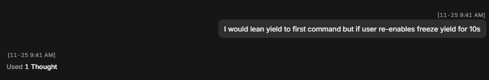

# opencode-timeline-timestamps

Wall-clock stamps beside every message in [OpenCode](https://opencode.ai) Desktop's chat timeline — so you can see *when* each turn actually happened.

> **Status: unsupported, and knowingly outside the contract.** OpenCode's plugin guide reserves the timeline for core — `session.header` is the only timeline surface it exposes to plugins. This plugin deliberately works outside that surface: it injects global CSS and decorates the app's own DOM. It is not endorsed by upstream, it depends on internal `data-*` attributes, and any Desktop update may break it. See [LIMITATIONS](#limitations--read-before-relying-on-this) before relying on it.



- **Display-only.** The stamp is a DOM decoration drawn in the window process from message metadata the app already has. No session hooks, no prompt or context mutation, no server-side text edits: the model can never receive these timestamps.
- **Zero dependencies, no build step.** One hand-written CommonJS file plus an inert server half.
- Options (`format`, `timezone`, `source`, …) live in `opencode.json` — no code editing needed. See [Options](#options).
- User stamps right-align with the user's bubble (row type read from the timeline tag, expressed as one CSS rule keyed off `data-role`); assistant, thinking, and shell stamps sit left. No role text is ever rendered.

## Install

### 1. Local directory (`file://`)

Clone wherever you keep code, then point your **global** config (`~/.config/opencode/opencode.json` on Linux/macOS, `%USERPROFILE%\.config\opencode\opencode.json` on Windows — the Desktop app reads plugins from the global config, not a project one) at the checkout:

```jsonc
{
  "plugins": [
    {
      "package": "file:///home/me/plugins/opencode-timeline-timestamps",
      "options": { "format": "compact", "timezone": "local", "source": "system" }
    }
  ]
}
```

The bare string form `"file:///…/opencode-timeline-timestamps"` also works whenever you pass no `options`. On Windows the path form is `file:///C:/Users/you/…`; an absolute path **without spaces** is recommended.

Saving the file is enough: the app watches the config and loads the plugin within seconds (verified on 2.4.1 — no restart). The sure sign it worked: `GET /api/plugin` on the app's own server lists it with `"features": {"server": true, "gui": true}`. **Note the `gui` half** — if it is missing, the app did not find the GUI bundle; see [Notes for maintainers](#notes-for-maintainers). Stamps then appear on every session window, and the plugin applies to every project/worktree the app shows.

One trap: a directory placed under `~/.config/opencode/plugins/` is **auto-discovered** even without a config entry. If you then add a `file://` entry to the same plugin, the second copy fails with `Duplicate plugin ID`. Keep exactly one registration.

### 2. Git package spec (auto-installed, no clone)

```jsonc
{ "plugins": [{ "package": "github:Nocterrible/opencode-timeline-timestamps" }] }
```

VERIFIED on 2.4.1 with this repo while private: the entry installs as a package (server reports `source.type: "package"` pinned to the installed commit hash) and still shows `"features": {"server": true, "gui": true}` — the installed-package form works with this package's deliberate **no-`exports`** layout. Git credentials for a private repo come from your machine's existing git auth (e.g. `gh` CLI's credential helper); the app prompts for nothing. Caveats that survived the test: a bare repo spec stays pinned to the commit it installed — add `#main` (or a `semver:` range) to follow updates, which the app checks on startup and every 24 h. If some future app version reports `server: true` without `gui: true`, the export map is the first suspect — see the maintainer note.

## Options

Attach `options` to the plugin entry. Changing options reloads the plugin (documented; verified — new stamps render within seconds of saving).

| Option | Default | Values |
| --- | --- | --- |
| `format` | `"compact"` | Preset `"compact"` → `[11-25 9:40 AM]`, `"time-only"` → `[9:40 AM]`, `"iso"` → `[2026-11-25 09:40:12]`, or a **token pattern**. Tokens: `YYYY MM DD HH hh h mm ss A`; every other character is literal (so `"MM/DD HH:mm"` and `"A h:mm"` do what you'd write). |
| `timezone` | `"local"` | The renderer's zone; `"UTC"`; a fixed offset `"+HH:MM"` / `"-HH:MM"` (one- or two-digit hours 0–14, minutes 00–59); or any IANA zone name (`"America/Denver"`, `"Asia/Kolkata"`, `"Europe/Berlin"`, …). An invalid name falls back to `local` and says so in the devtools console. |
| `source` | `"system"` | `"system"` — stamp the message's `time.created`, which is the OpenCode **server's** clock. `"network"` — additionally calibrate against an HTTP time endpoint (see below). |
| `timeUrl` | `https://timeapi.io/api/time/current/zone?timeZone=UTC` | With `source: "network"`: any URL returning a parseable time — epoch seconds or ms (numbers or numeric strings), e.g. `epoch` / `epoch_ms` / `epochMs` / `unixtime` / `timestamp` fields, an ISO-8601 string (with or without a `Z`/`±HH:MM`/`±HHMM` suffix — naive ISO is assumed UTC) under `dateTime`/`utc`/`iso`, or a timeapi.io-style `{"year":…,"month":…,"day":…}` body. |
| `syncMinutes` | `60` | Resync period for the network calibration; values below 1 clamp to 1 minute (0 or unset means the 60-minute default). |

Notes on the choices:

- **Fixed offsets shift the epoch and read UTC fields** — they do not string-map to `Etc/GMT±N`, whose sign is *inverted* (`Etc/GMT+5` is UTC−5). If you want a hard −5, write `"-05:00"` (or `"Etc/GMT+5"` and let `Intl` apply the zone database's own, correct, quirk).
- IANA zones follow real DST via the platform's `Intl` tables: `America/Denver` renders 05:00 for a January noon-UTC stamp and 06:00 for a July one.
- **`source: "system"` already means "the server's clock", not "your PC's clock"** — `time.created` is stamped by the OpenCode server that created the message. On the desktop app that server runs on your machine, so there is no meaningful `"server"` source option left to offer: it would be an alias for `"system"`. The `"network"` source earns its keep when the server is *remote* and its clock is not yours to trust. Raw NTP (UDP/123) is unreachable from an Electron renderer, so `"network"` is honestly an HTTP time check: it fetches `timeUrl`, records the offset against the renderer clock once, and adds that offset to every stamp until the next resync. Until the first success, stamps show `[time unavailable]`; after a success, a failed resync keeps the last known offset and logs it rather than blanking the timeline.

## Failure mode

A stamp whose time cannot be determined shows a loud amber **`[time unavailable]`** instead of a plausible wrong time — intentional: a silently-falling-back clock is the bug class this plugin cares about. It appears when `source: "network"` has not synced yet, when a message genuinely carries no creation time, or while the app's message store is mid-reload.

## Uninstall

Delete the plugin entry from `opencode.json` (or add `"-timeline-timestamps"` to the array). Stamps disappear on the next reload; the plugin never wrote anything to your sessions.

## LIMITATIONS — read before relying on this

- **This is outside the supported plugin contract.** Upstream's own GUI-plugin doctrine for the timeline is, verbatim, **"No timeline work."** — `session.header` is the only timeline surface the host hands plugins. This plugin therefore injects global CSS and mutates the app's own timeline DOM instead of using a supported extension point: nothing here can corrupt your sessions (the plugin writes no data), but the app update cycle is free to reflow the DOM this decorates, and no upstream change owes this plugin a compatibility pass.
- **The request exists and was declined.** Issue [#44588](https://github.com/anomalyco/opencode/issues/44588) ("Date time format in the conversation") was closed as *not planned*, and [PR #45590](https://github.com/anomalyco/opencode/pull/45590) (a timestamp on the message meta line) was closed unmerged. The public SDK docs, <https://opencode.ai/docs/build/plugins/gui>, list the supported surfaces and include no message row. The doctrine line quoted above lives in the repo guide `packages/gui-plugins/README.md`, "Runtime rules".
- **The app already shows a per-message time — behind a menu.** Hover a user message, click the chevron ("More actions"), and the first row is `Today, 10:05 AM`. That is useful once; it is useless for scanning an overnight session. This plugin's only job is to surface that number without the click, on every row type.
- **It depends on internal `data-*` attributes** (`data-timeline-row`, `data-message-id`, `data-timeline-part-id(s)`, `data-slot="session-turn-message-container"`). When some future Desktop update renames those, stamps vanish or misplace — by design of the surface, not by bug in this implementation. The repair is a few selector edits; expect occasional attention.
- **Tested on OpenCode Desktop 2.4.1 (Windows).** The GUI plugin API is explicitly experimental (the `-experimental` in `gui-experimental` says so); other versions are unproven. The config-reload path and the `github:` install were each verified only on that build.
- **`[time unavailable]` is a designed failure mode, not a defect** — see [Failure mode](#failure-mode).
- **No upstream endorsement.** "OpenCode" and its timeline layout belong to the OpenCode project; this is an independent plugin and nothing here reflects official roadmap.
- Screenshot hygiene: the image above is a real session of the author's, so it shows other conversations' text. Replace it before taking the repo public.

## Notes for maintainers

- **Do not add an `"exports"` field to `package.json` without re-proving `"features": {"server": true, "gui": true}` on `/api/plugin`.** Measured on 2.4.1 with `file://` installs: with an `exports` map the app resolved `./gui-experimental` through the package name and silently produced **no GUI** (`server: true` only, and no toggle under Settings > Extensions). Without `exports`, the root `gui-experimental.cjs` loads and both halves appear. The current layout is deliberate, not an omission.
- The repo root **is** the plugin directory (no build step): edit `gui-experimental.cjs` in place and the config watcher reloads every window. The `test/` harness (`node test/options.test.cjs`, zero dependencies) covers the options core — format presets, a 2000-epoch legacy-format parity sweep, zone math including DST and the `Etc/GMT` sign inversion, the payload parser's accepted shapes, and the network-clock state machine including the retry schedule and stop-during-in-flight teardown. Run it before pushing; it never launches the app and prints `PASS <n> assertions, 0 failed` on the last line (fake-fetch console noise above it is expected).
- The plugin registers **no** chat/prompt/permission hooks by design; `index.ts` is an empty server setup so the desktop lists the plugin. Any future hook that *reads or rewrites message text* must not touch stamps — keep the model blind to them.
- The one test trick worth knowing: the network source can be exercised against `data:` URLs (e.g. `"data:application/json,%7B%22epoch%22%3A1000000000%7D"` for a pinned 2001 epoch) — a decisive, offline, visibly-shifted calibration in the real renderer.

## License

MIT — see [LICENSE](LICENSE).
